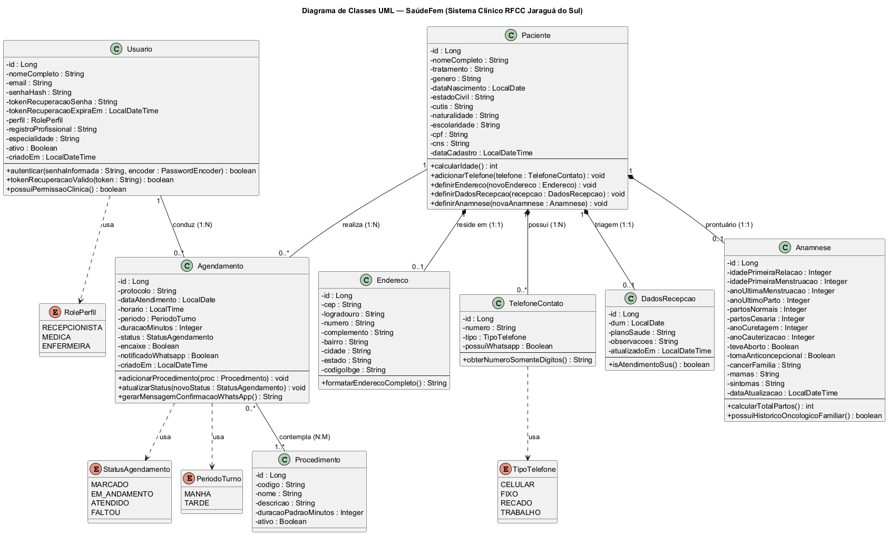

# Documentação Formal — Etapa 1: Concepção, Requisitos, Arquitetura e Persistência

---

## Identificação da Equipe

| Papel | Nome Completo |
| :--- | :--- |
| **Líder da Equipe** | Vitor Augusto Rinkawetsky |
| **Integrante 2** | Davi Simplicio |
| **Integrante 3** | Gabriel Koehler da Silva |
| **Integrante 4** | Jonatas Jackson Gonçalves |
| **Integrante 5** | Wesley Diorrani Ferreira |

- **Repositório Git (Código-Fonte):** <https://github.com/Davi-Simplicio/RFC-Clinica-backend>
- **Data Limite de Entrega:** 26/10 às 23h59

---

## 1. Visão Geral do Projeto

### 1.1 Nome do Produto
- **Nome Comercial:** **SaúdeFem** — Sistema de Gestão Clínica e Prontuário Ginecológico/Oncológico.
- **Nome Técnico:** `saudefem-rfcc-system` — Plataforma Web e API REST para Gestão de Agenda, Recepção, Triagem e Anamnese Clínica da **Rede Feminina de Combate ao Câncer (RFCC) de Jaraguá do Sul / SC**.

### 1.2 Declaração do Problema e Justificativa
A **Rede Feminina de Combate ao Câncer (RFCC) de Jaraguá do Sul — SC** realiza diariamente dezenas de atendimentos voltados à saúde da mulher, incluindo exames preventivos (Papanicolaou/Citopatológico), exames clínicos de mamas, colposcopias, ultrassonografias pélvicas e consultas ginecológicas/mastológicas — atendendo tanto pelo SUS quanto por convênios e modalidade particular/social.

Historicamente, clínicas filantrópicas e ambulatoriais enfrentam gargalos operacionais críticos quando dependem de fichas em papel, planilhas descentralizadas ou sistemas genéricos que não contemplam a especificidade ginecológica e oncológica:
1. **Fragmentação de Dados Clínicos e Cadastrais:** Dificuldade em localizar rapidamente o histórico reprodutivo (D.U.M., paridade, curetagens, cauterizações, histórico familiar de câncer de mama/colo de útero) durante a consulta médica.
2. **Desorganização no Fluxo da Agenda Diária:** Falta de visibilidade em tempo real entre a recepção e os consultórios médicos/enfermagem sobre o status da paciente (*Marcado*, *Em Andamento*, *Atendido*, *Faltou*), além de dificuldade na alocação de **encaixes emergenciais** divididos por turnos (Manhã e Tarde).
3. **Elevado Índice de Absenteísmo (Faltas):** Ausência de confirmação ativa e padronizada de consultas via WhatsApp com número de protocolo, data, horário e preparo de exame.
4. **Erros de Preenchimento Cadastral:** Digitação manual de endereços sem validação de CEP/IBGE e ausência de padronização de documentos como CPF e Cartão Nacional de Saúde (CNS/SUS).

**Justificativa:** O desenvolvimento do **SaúdeFem** justifica-se pela necessidade de digitalizar, padronizar e agilizar todo o fluxo de atendimento da RFCC Jaraguá do Sul, integrando recepção, enfermagem e corpo clínico em uma interface moderna, intuitiva e apoiada por uma arquitetura de persistência relacional robusta e auditável.

### 1.3 Público-Alvo e Objetivos do Sistema

#### Público-Alvo
1. **Recepcionistas e Equipe de Triagem (RFCC):** Responsáveis pelo agendamento diário, controle de presença, inserção de encaixes, confirmação via WhatsApp, validação cadastral (CPF, CNS, Endereço via CEP, múltiplos telefones) e coleta inicial de recepção (D.U.M. e convênio).
2. **Médicas Ginecologistas e Mastologistas:** Responsáveis pela condução das consultas clínicas, preenchimento e revisão de anamnese estruturada (histórico reprodutivo, oncológico familiar, avaliação clínica das mamas e sintomas).
3. **Profissionais de Enfermagem:** Responsáveis pela triagem assistencial, apoio em exames preventivos e execução de procedimentos ambulatoriais.
4. **Pacientes Assistidas pela RFCC (Beneficiárias Indiretas):** Mulheres da comunidade de Jaraguá do Sul e região que recebem notificações claras via WhatsApp e um atendimento ágil, humanizado e seguro.

#### Proposta de Valor e Objetivos do Sistema
- **Objetivo Geral:** Prover um sistema clínico integrado para a RFCC Jaraguá do Sul que centralize a agenda diária de atendimentos e o prontuário eletrônico feminino (cadastro, endereço, contatos, recepção e anamnese oncológica/ginecológica).
- **Objetivos Específicos:**
  - Controlar o acesso e a experiência de uso por perfil profissional (**Recepcionista**, **Médica** e **Enfermeira**).
  - Organizar a agenda clínica diária por turnos (**Manhã** e **Tarde**, com intervalo de almoço), permitindo filtros instantâneos por status e busca global por paciente, protocolo ou procedimento.
  - Agilizar o cadastro e atualização de pacientes em uma gaveta lateral (*Drawer*) dividida em 5 abas estruturadas (*Dados Pessoais*, *Endereço*, *Contatos*, *Recepção* e *Anamnese*), com cálculo automático de idade e integração com a API **ViaCEP**.
  - Reduzir faltas por meio da geração automatizada e envio de confirmações de agendamento via **WhatsApp** (`wa.me`).
  - Garantir integridade transacional e persistência relacional estruturada utilizando **Spring Boot 3 + Spring Data JPA (Hibernate)** no backend e **Next.js + TypeScript** no frontend.

---

## 2. Especificação de Requisitos

### 2.1 Requisitos Funcionais (RF)

| Código | Requisito Funcional | Descrição Detalhada |
| :--- | :--- | :--- |
| **RF01** | **Autenticação e Seleção de Perfil de Acesso** | O sistema deve permitir que profissionais autorizados realizem login informando e-mail, senha e selecionando seu perfil operacional (`Recepcionista`, `Médica` ou `Enfermeira`), adaptando a identificação visual e permissões da sessão, além de oferecer fluxo de recuperação de senha por e-mail. |
| **RF02** | **Visualização e Gestão da Agenda Clínica Diária** | O sistema deve exibir o dashboard da agenda do dia organizado cronologicamente por períodos (**Manhã** e **Tarde**, separados por indicador de intervalo de almoço), apresentando em cada card o protocolo (`PROT-AAAA-NNNN`), horário, duração prevista, nome da paciente, procedimento(s), médica responsável e status. |
| **RF03** | **Filtro por Status e Busca Global na Agenda** | O sistema deve contabilizar e permitir filtrar em tempo real os agendamentos do dia pelos status `Todos`, `Marcado`, `Em Andamento`, `Atendido` e `Faltou`, bem como realizar busca textual instantânea por nome da paciente, código de protocolo ou nome do procedimento. |
| **RF04** | **Atualização Rápida de Status do Agendamento** | O sistema deve permitir alterar o status de qualquer agendamento (`MARCADO`, `EM_ANDAMENTO`, `ATENDIDO`, `FALTOU`) diretamente a partir do card da agenda ou de dentro da gaveta de prontuário da paciente, refletindo imediatamente nos contadores do dia. |
| **RF05** | **Inclusão de Encaixe Emergencial (+ Encaixe)** | O sistema deve oferecer um modal específico para inserção rápida de atendimentos extras/emergenciais no dia ("Encaixe"), vinculando uma paciente cadastrada, horário, turno (`MANHÃ` ou `TARDE`), procedimento e médica responsável, gerando número de protocolo único automaticamente. |
| **RF06** | **Atribuição de Paciente à Médica (Agendamento)** | O sistema deve permitir agendar/atribuir uma paciente a uma profissional médica específica (`Dra. Ana Beatriz`, `Dra. Camila Duarte`, etc.), definindo o procedimento clínico, horário agendado e duração estimada (`20 min`, `30 min`, `40 min`, `60 min`). |
| **RF07** | **Gerenciamento de Dados Pessoais da Paciente** | O sistema deve permitir cadastrar, listar, buscar (por nome, CPF ou convênio) e editar pacientes com nome completo, pronome de tratamento (`Sra.`, `Srta.`), gênero, data de nascimento (com cálculo automático da idade em anos), estado civil, cútis, naturalidade, escolaridade, CPF e Cartão Nacional de Saúde (CNS). |
| **RF08** | **Gestão de Endereço com Consulta Automática de CEP** | O sistema deve manter o endereço completo da paciente (CEP, logradouro, número, complemento, bairro, cidade, UF e código IBGE) e disponibilizar integração automática com o serviço **ViaCEP** para autopreenchimento de logradouro, bairro, município, UF e código IBGE a partir do CEP informado. |
| **RF09** | **Gestão de Múltiplos Contatos Telefônicos** | O sistema deve permitir associar múltiplos números de telefone a uma mesma paciente, classificando cada contato por tipo (`Celular`, `Fixo`, `Recado`, `Trabalho`) e indicando individualmente via *switch* booleano se o número possui **WhatsApp** ativo. |
| **RF10** | **Registro de Triagem de Recepção** | O sistema deve permitir que a recepção registre e atualize na ficha da paciente a **Data da Última Menstruação (D.U.M.)**, o **Plano de Saúde / Convênio** (`Particular`, `SUS`, `Unimed`, `Bradesco Saúde`, etc.) e observações gerais de acolhimento/recepção. |
| **RF11** | **Prontuário de Anamnese Ginecológica e Oncológica** | O sistema deve disponibilizar uma aba clínica de Anamnese contendo: histórico reprodutivo (idade da 1ª relação e 1ª menstruação, ano da última menstruação, ano do último parto, quantidade de partos normais e cesáreas, ano de curetagem, ano de cauterização, indicadores booleanos de aborto prévio e uso de anticoncepcional) e avaliação descritiva rica (**Câncer na Família**, **Exame de Mamas** e **Sintomas**). |
| **RF12** | **Confirmação de Consulta Integrada ao WhatsApp** | O sistema deve gerar automaticamente uma prévia de mensagem personalizada contendo saudação com o primeiro nome da paciente, data, horário, procedimento e protocolo do agendamento, permitindo editar o texto antes do envio e redirecionando para a API oficial do WhatsApp (`https://wa.me/55...`) no telefone habilitado da paciente. |

---

### 2.2 Requisitos Não Funcionais (RNF)

| Código | Categoria | Requisito Não Funcional | Especificação Técnica |
| :--- | :--- | :--- | :--- |
| **RNF01** | **Desempenho e Responsividade** | Tempo de resposta em consultas e filtros | As operações de listagem da agenda diária, filtragem por status e busca de pacientes devem responder em tempo inferior a **200 ms** no cliente e **500 ms** em chamadas de API REST (p95), utilizando índices compostos em `data_atendimento`, `horario`, `status` e `cpf`. |
| **RNF02** | **Segurança e Controle de Acesso (RBAC)** | Autenticação segura e segregação por papéis | As senhas dos usuários (`tb_usuarios`) devem ser armazenadas exclusivamente sob hash criptográfico (`BCrypt`, via `spring-security-crypto`), sendo a verificação feita com `PasswordEncoder.matches()` (`Usuario.autenticar()`); tokens de recuperação de senha possuem prazo de expiração. O controle de acesso deve ser baseado em papéis (`RolePerfil`: `RECEPCIONISTA`, `MEDICA`, `ENFERMEIRA`) e em conformidade com a **LGPD (Lei nº 13.709/2018)** por tratar dados pessoais sensíveis de saúde. |
| **RNF03** | **Banco de Dados e Persistência (JPA)** | Integridade relacional e mapeamento ORM | A camada de persistência deve utilizar **Java 21 + Spring Boot 3.3 + Spring Data JPA (Hibernate)**, compatível com **PostgreSQL 16** (perfil `prod`) e **H2 Database** (perfil `dev` e testes), com chaves estrangeiras explícitas e restrições de unicidade (`UNIQUE`) para CPF, e-mail de usuário, código de procedimento e protocolo de agendamento. A camada de serviço (Etapa 2) deverá garantir transações ACID com `@Transactional`. O histórico de agendamentos não é removido em cascata ao excluir uma paciente (guarda de prontuário). |
| **RNF04** | **Padrões de Arquitetura REST** | Design de API RESTful padronizado | A comunicação entre o frontend (**Next.js 16 / React 19**) e o backend (**Spring Web**) deve seguir o padrão **RESTful** sobre HTTP/HTTPS com payloads em **JSON (UTF-8)**, uso semântico de verbos HTTP (`GET`, `POST`, `PUT`, `PATCH`, `DELETE`), códigos de status padronizados (`200 OK`, `201 Created`, `400 Bad Request`, `404 Not Found`, `422 Unprocessable Entity`) e validação via **Jakarta Bean Validation** (`@NotBlank`, `@NotNull`, `@Email`). |
| **RNF05** | **Usabilidade e Acessibilidade Visual** | Interface clínica de alto contraste e baixo esforço cognitivo | A interface gráfica deve seguir fielmente o Design System da RFCC Jaraguá do Sul (Tailwind CSS v4), utilizando codificação cromática semântica para os status da agenda (Rosa/Magenta para *Marcado*, Âmbar para *Em Andamento*, Verde Esmeralda para *Atendido*, Cinza Ardósia para *Faltou*) e máscaras automáticas de entrada para CPF, CNS, CEP e Telefone. |
| **RNF06** | **Interoperabilidade Externa** | Integração com serviços públicos e mensageria | O sistema deve integrar-se via HTTPS REST à API pública **ViaCEP** (`https://viacep.com.br/ws/{cep}/json/`) para consulta de logradouros e código municipal IBGE, e ao protocolo de deep-linking **WhatsApp Web/Mobile** (`https://wa.me/`). |

---

## 3. Arquitetura e Modelagem de Dados

### 3.1 Diagrama de Classes UML

O modelo de domínio do sistema **SaúdeFem (RFCC Jaraguá do Sul)** foi projetado contemplando **8 classes de entidade persistentes (`@Entity`)** e **4 enumerações de domínio**, cobrindo todas as cardinalidades exigidas:
- **Relacionamentos `1:1` (`@OneToOne`):**
  - `Paciente` `1` $\leftrightarrow$ `0..1` `Endereco`: Cada paciente possui no máximo um endereço residencial estruturado com CEP e código IBGE (pode ser preenchido após o cadastro inicial).
  - `Paciente` `1` $\leftrightarrow$ `0..1` `DadosRecepcao`: Cada paciente possui um registro de triagem da recepção (D.U.M., plano de saúde e observações).
  - `Paciente` `1` $\leftrightarrow$ `0..1` `Anamnese`: Cada paciente possui sua ficha de anamnese ginecológica/oncológica atualizada.
- **Relacionamentos `1:N` / `N:1` (`@OneToMany` / `@ManyToOne`):**
  - `Paciente` `1` $\leftrightarrow$ `0..*` `TelefoneContato`: Uma paciente pode cadastrar nenhum, um ou vários telefones de contato (celular, fixo, recado, trabalho).
  - `Paciente` `1` $\leftrightarrow$ `0..*` `Agendamento`: Uma paciente pode ter múltiplos agendamentos ao longo do tempo na clínica.
  - `Usuario` `1` $\leftrightarrow$ `0..*` `Agendamento`: Uma profissional de saúde (Médica/Enfermeira) conduz diversos agendamentos na agenda diária.
- **Relacionamento `N:M` (`@ManyToMany`):**
  - `Agendamento` `0..*` $\leftrightarrow$ `1..*` `Procedimento`: Um agendamento clínico contempla obrigatoriamente um ou mais procedimentos/exames (`@NotEmpty`; ex.: *Exame de Mama* + *Preventivo Citopatológico*), e um mesmo procedimento do catálogo da clínica está presente em inúmeros agendamentos (mapeado via tabela associativa `tb_agendamento_procedimentos`).
- **Composição (losango preenchido):** `Endereco`, `TelefoneContato`, `DadosRecepcao` e `Anamnese` pertencem ao ciclo de vida da `Paciente` (`cascade = ALL` + `orphanRemoval = true`).



*Fonte equivalente em Mermaid:*

```mermaid
classDiagram
    direction TB

    class RolePerfil {
        <<enumeration>>
        RECEPCIONISTA
        MEDICA
        ENFERMEIRA
    }

    class StatusAgendamento {
        <<enumeration>>
        MARCADO
        EM_ANDAMENTO
        ATENDIDO
        FALTOU
    }

    class PeriodoTurno {
        <<enumeration>>
        MANHA
        TARDE
    }

    class TipoTelefone {
        <<enumeration>>
        CELULAR
        FIXO
        RECADO
        TRABALHO
    }

    class Usuario {
        -Long id
        -String nomeCompleto
        -String email
        -String senhaHash
        -String tokenRecuperacaoSenha
        -LocalDateTime tokenRecuperacaoExpiraEm
        -RolePerfil perfil
        -String registroProfissional
        -String especialidade
        -Boolean ativo
        -LocalDateTime criadoEm
        +autenticar(String senhaInformada, PasswordEncoder encoder) boolean
        +tokenRecuperacaoValido(String token) boolean
        +possuiPermissaoClinica() boolean
    }

    class Paciente {
        -Long id
        -String nomeCompleto
        -String tratamento
        -String genero
        -LocalDate dataNascimento
        -String estadoCivil
        -String cutis
        -String naturalidade
        -String escolaridade
        -String cpf
        -String cns
        -LocalDateTime dataCadastro
        +calcularIdade() int
        +adicionarTelefone(TelefoneContato telefone) void
        +definirEndereco(Endereco novoEndereco) void
        +definirDadosRecepcao(DadosRecepcao recepcao) void
        +definirAnamnese(Anamnese novaAnamnese) void
    }

    class Endereco {
        -Long id
        -String cep
        -String logradouro
        -String numero
        -String complemento
        -String bairro
        -String cidade
        -String estado
        -String codigoIbge
        +formatarEnderecoCompleto() String
    }

    class TelefoneContato {
        -Long id
        -String numero
        -TipoTelefone tipo
        -Boolean possuiWhatsapp
        +obterNumeroSomenteDigitos() String
    }

    class DadosRecepcao {
        -Long id
        -LocalDate dum
        -String planoSaude
        -String observacoes
        -LocalDateTime atualizadoEm
        +isAtendimentoSus() boolean
    }

    class Anamnese {
        -Long id
        -Integer idadePrimeiraRelacao
        -Integer idadePrimeiraMenstruacao
        -Integer anoUltimaMenstruacao
        -Integer anoUltimoParto
        -Integer partosNormais
        -Integer partosCesaria
        -Integer anoCuretagem
        -Integer anoCauterizacao
        -Boolean teveAborto
        -Boolean tomaAnticoncepcional
        -String cancerFamilia
        -String mamas
        -String sintomas
        -LocalDateTime dataAtualizacao
        +calcularTotalPartos() int
        +possuiHistoricoOncologicoFamiliar() boolean
    }

    class Agendamento {
        -Long id
        -String protocolo
        -LocalDate dataAtendimento
        -LocalTime horario
        -PeriodoTurno periodo
        -Integer duracaoMinutos
        -StatusAgendamento status
        -Boolean encaixe
        -Boolean notificadoWhatsapp
        -LocalDateTime criadoEm
        +adicionarProcedimento(Procedimento proc) void
        +atualizarStatus(StatusAgendamento novoStatus) void
        +gerarMensagemConfirmacaoWhatsApp() String
    }

    class Procedimento {
        -Long id
        -String codigo
        -String nome
        -String descricao
        -Integer duracaoPadraoMinutos
        -Boolean ativo
    }

    Paciente "1" *-- "0..1" Endereco : reside em (1:1)
    Paciente "1" *-- "0..*" TelefoneContato : possui (1:N)
    Paciente "1" *-- "0..1" DadosRecepcao : triagem recepcao (1:1)
    Paciente "1" *-- "0..1" Anamnese : prontuario clinico (1:1)
    Paciente "1" -- "0..*" Agendamento : agenda (1:N)
    Usuario "1" -- "0..*" Agendamento : atende / responsavel (1:N)
    Agendamento "0..*" -- "1..*" Procedimento : inclui exames/procedimentos (N:M)

    Usuario ..> RolePerfil : usa
    TelefoneContato ..> TipoTelefone : usa
    Agendamento ..> StatusAgendamento : usa
    Agendamento ..> PeriodoTurno : usa
```

> **Arquivos de Modelagem no Repositório:**
> - Mermaid UML: [`docs/diagrama_classes.mmd`](diagrama_classes.mmd)
> - PlantUML: [`docs/diagrama_classes.puml`](diagrama_classes.puml)
> - Imagem renderizada: [`docs/diagrama_classes.png`](diagrama_classes.png)

---

### 3.2 Mapeamento de Entidades JPA e Dicionário de Dados

A camada de persistência foi implementada em **Spring Boot 3 + Spring Data JPA** no diretório [`src/main/java/br/org/rfcc/saudefem`](../src/main/java/br/org/rfcc/saudefem) (entidades em `domain/entity`, repositórios em `repository`), superando o requisito mínimo de 5 entidades ao disponibilizar **8 entidades JPA (`@Entity`)** e **8 interfaces `JpaRepository`**. O mapeamento é verificado pelo teste de integração [`PersistenciaJpaTest`](../src/test/java/br/org/rfcc/saudefem/repository/PersistenciaJpaTest.java) (`@DataJpaTest` sobre H2), executado com `./mvnw verify`.

#### Visão Geral das Entidades e Repositórios Implementados

| # | Entidade JPA (`@Entity`) | Tabela Física | Relacionamentos JPA Mapeados | Repositório Spring Data JPA |
| :-: | :--- | :--- | :--- | :--- |
| **1** | `Usuario` | `tb_usuarios` | `@OneToMany(mappedBy = "profissionalResponsavel")` $\rightarrow$ `Agendamento` (1:N) | `UsuarioRepository` |
| **2** | `Paciente` | `tb_pacientes` | `@OneToOne` $\rightarrow$ `Endereco` (1:1)<br>`@OneToMany` $\rightarrow$ `TelefoneContato` (1:N)<br>`@OneToOne` $\rightarrow$ `DadosRecepcao` (1:1)<br>`@OneToOne` $\rightarrow$ `Anamnese` (1:1)<br>`@OneToMany` $\rightarrow$ `Agendamento` (1:N) | `PacienteRepository` |
| **3** | `Endereco` | `tb_enderecos` | `@OneToOne` + `@JoinColumn(name = "paciente_id", unique = true)` $\rightarrow$ `Paciente` (1:1) | `EnderecoRepository` |
| **4** | `TelefoneContato` | `tb_telefones_contato` | `@ManyToOne` + `@JoinColumn(name = "paciente_id")` $\rightarrow$ `Paciente` (N:1) | `TelefoneContatoRepository` |
| **5** | `DadosRecepcao` | `tb_dados_recepcao` | `@OneToOne` + `@JoinColumn(name = "paciente_id", unique = true)` $\rightarrow$ `Paciente` (1:1) | `DadosRecepcaoRepository` |
| **6** | `Anamnese` | `tb_anamneses` | `@OneToOne` + `@JoinColumn(name = "paciente_id", unique = true)` $\rightarrow$ `Paciente` (1:1) | `AnamneseRepository` |
| **7** | `Procedimento` | `tb_procedimentos` | `@ManyToMany(mappedBy = "procedimentos")` $\rightarrow$ `Agendamento` (N:M) | `ProcedimentoRepository` |
| **8** | `Agendamento` | `tb_agendamentos` | `@ManyToOne` $\rightarrow$ `Paciente` (N:1)<br>`@ManyToOne` $\rightarrow$ `Usuario` (N:1)<br>`@ManyToMany` + `@JoinTable(name = "tb_agendamento_procedimentos")` $\rightarrow$ `Procedimento` (N:M) | `AgendamentoRepository` |

---

#### Dicionário de Dados Detalhado

##### 1. Tabela `tb_usuarios` (Entidade `Usuario`)
Armazena as credenciais e perfis das profissionais da clínica (Recepcionistas, Médicas e Enfermeiras).

| Coluna | Atributo Java | Tipo SQL | Tipo Java | Restrições | Descrição |
| :--- | :--- | :--- | :--- | :--- | :--- |
| `id` | `id` | `BIGINT` | `Long` | `PK`, `AUTO_INCREMENT` | Identificador único do usuário/profissional. |
| `nome_completo` | `nomeCompleto` | `VARCHAR(120)` | `String` | `NOT NULL` | Nome completo da profissional (ex: Dra. Ana Beatriz). |
| `email` | `email` | `VARCHAR(150)` | `String` | `NOT NULL`, `UNIQUE` | E-mail institucional de login (`@rfcc.org.br`). |
| `senha_hash` | `senhaHash` | `VARCHAR(255)` | `String` | `NOT NULL` | Hash BCrypt da senha de acesso. |
| `token_recuperacao_senha` | `tokenRecuperacaoSenha` | `VARCHAR(100)` | `String` | `NULL`, `UNIQUE` | Token enviado por e-mail no fluxo de recuperação de senha (RF01). |
| `token_recuperacao_expira_em` | `tokenRecuperacaoExpiraEm` | `TIMESTAMP` | `LocalDateTime` | `NULL` | Data/hora de expiração do token de recuperação. |
| `perfil` | `perfil` | `VARCHAR(30)` | `RolePerfil` | `NOT NULL` | Papel de acesso: `RECEPCIONISTA`, `MEDICA` ou `ENFERMEIRA`. |
| `registro_profissional` | `registroProfissional` | `VARCHAR(40)` | `String` | `NULL` | Registro no conselho de classe (CRM/SC ou COREN/SC). |
| `especialidade` | `especialidade` | `VARCHAR(80)` | `String` | `NULL` | Especialidade clínica (ex: Ginecologista / Mastologista). |
| `ativo` | `ativo` | `BOOLEAN` | `Boolean` | `NOT NULL`, `DEFAULT TRUE` | Indica se o cadastro da profissional está ativo. |
| `criado_em` | `criadoEm` | `TIMESTAMP` | `LocalDateTime` | `NOT NULL` | Data/hora de criação do registro. |

##### 2. Tabela `tb_pacientes` (Entidade `Paciente`)
Armazena os dados pessoais e documentos de identificação das pacientes assistidas pela RFCC.

| Coluna | Atributo Java | Tipo SQL | Tipo Java | Restrições | Descrição |
| :--- | :--- | :--- | :--- | :--- | :--- |
| `id` | `id` | `BIGINT` | `Long` | `PK`, `AUTO_INCREMENT` | Identificador único da paciente. |
| `nome_completo` | `nomeCompleto` | `VARCHAR(150)` | `String` | `NOT NULL`, `INDEX` | Nome civil completo da paciente. |
| `tratamento` | `tratamento` | `VARCHAR(20)` | `String` | `NULL` | Pronome de tratamento (`Sra.`, `Srta.`). |
| `genero` | `genero` | `VARCHAR(30)` | `String` | `DEFAULT 'Feminino'` | Identidade de gênero da paciente. |
| `data_nascimento` | `dataNascimento` | `DATE` | `LocalDate` | `NOT NULL` | Data de nascimento (base para `calcularIdade()`). |
| `estado_civil` | `estadoCivil` | `VARCHAR(40)` | `String` | `NULL` | Estado civil (`Solteira`, `Casada`, `Divorciada`, `União Estável`, `Viúva`). |
| `cutis` | `cutis` | `VARCHAR(30)` | `String` | `NULL` | Cor/etnia declarada (`Branca`, `Parda`, `Negra`, `Amarela`, `Indígena`). |
| `naturalidade` | `naturalidade` | `VARCHAR(100)` | `String` | `NULL` | Cidade e UF de nascimento (ex: `Jaraguá do Sul, SC`). |
| `escolaridade` | `escolaridade` | `VARCHAR(60)` | `String` | `NULL` | Grau de instrução (`Ensino Médio`, `Ensino Superior`, `Pós-graduação`, etc.). |
| `cpf` | `cpf` | `VARCHAR(14)` | `String` | `NOT NULL`, `UNIQUE` | Cadastro de Pessoa Física formatado (`000.000.000-00`). |
| `cns` | `cns` | `VARCHAR(25)` | `String` | `NULL`, `INDEX` | Cartão Nacional de Saúde (SUS) com 15 dígitos. |
| `data_cadastro` | `dataCadastro` | `TIMESTAMP` | `LocalDateTime` | `NOT NULL` | Data e hora do cadastro inicial na clínica. |

##### 3. Tabela `tb_enderecos` (Entidade `Endereco`)
Armazena o endereço residencial da paciente em relacionamento `1:1` com `tb_pacientes`.

| Coluna | Atributo Java | Tipo SQL | Tipo Java | Restrições | Descrição |
| :--- | :--- | :--- | :--- | :--- | :--- |
| `id` | `id` | `BIGINT` | `Long` | `PK`, `AUTO_INCREMENT` | Identificador único do endereço. |
| `paciente_id` | `paciente` | `BIGINT` | `Paciente` | `FK`, `NOT NULL`, `UNIQUE` | Chave estrangeira `1:1` referenciando `tb_pacientes(id)`. |
| `cep` | `cep` | `VARCHAR(10)` | `String` | `NOT NULL` | Código de Endereçamento Postal (`00000-000`). |
| `logradouro` | `logradouro` | `VARCHAR(150)` | `String` | `NOT NULL` | Rua, avenida ou travessa. |
| `numero` | `numero` | `VARCHAR(20)` | `String` | `NULL` | Número predial ou `S/N`. |
| `complemento` | `complemento` | `VARCHAR(100)` | `String` | `NULL` | Apartamento, bloco, condomínio ou referência. |
| `bairro` | `bairro` | `VARCHAR(100)` | `String` | `NOT NULL` | Bairro ou setor. |
| `cidade` | `cidade` | `VARCHAR(100)` | `String` | `NOT NULL` | Nome do município (ex: `Jaraguá do Sul`). |
| `estado` | `estado` | `VARCHAR(2)` | `String` | `NOT NULL` | Sigla da Unidade Federativa (ex: `SC`). |
| `codigo_ibge` | `codigoIbge` | `VARCHAR(15)` | `String` | `NULL` | Código oficial do município no IBGE (ex: `4208905`). |

##### 4. Tabela `tb_telefones_contato` (Entidade `TelefoneContato`)
Armazena os múltiplos telefones de contato da paciente (`1:N`).

| Coluna | Atributo Java | Tipo SQL | Tipo Java | Restrições | Descrição |
| :--- | :--- | :--- | :--- | :--- | :--- |
| `id` | `id` | `BIGINT` | `Long` | `PK`, `AUTO_INCREMENT` | Identificador único do telefone. |
| `paciente_id` | `paciente` | `BIGINT` | `Paciente` | `FK`, `NOT NULL` | Chave estrangeira `N:1` referenciando `tb_pacientes(id)`. |
| `numero` | `numero` | `VARCHAR(25)` | `String` | `NOT NULL` | Número formatado com DDD (ex: `(47) 9 9123-4567`). |
| `tipo` | `tipo` | `VARCHAR(20)` | `TipoTelefone` | `NOT NULL` | Tipo do contato: `CELULAR`, `FIXO`, `RECADO` ou `TRABALHO`. |
| `possui_whatsapp` | `possuiWhatsapp` | `BOOLEAN` | `Boolean` | `NOT NULL`, `DEFAULT TRUE` | Indica se o número recebe notificações via WhatsApp. |

##### 5. Tabela `tb_dados_recepcao` (Entidade `DadosRecepcao`)
Armazena as informações de triagem administrativa e recepção da paciente (`1:1`).

| Coluna | Atributo Java | Tipo SQL | Tipo Java | Restrições | Descrição |
| :--- | :--- | :--- | :--- | :--- | :--- |
| `id` | `id` | `BIGINT` | `Long` | `PK`, `AUTO_INCREMENT` | Identificador único do registro de recepção. |
| `paciente_id` | `paciente` | `BIGINT` | `Paciente` | `FK`, `NOT NULL`, `UNIQUE` | Chave estrangeira `1:1` referenciando `tb_pacientes(id)`. |
| `dum` | `dum` | `DATE` | `LocalDate` | `NULL` | Data da Última Menstruação (D.U.M.). |
| `plano_saude` | `planoSaude` | `VARCHAR(60)` | `String` | `NOT NULL` | Convênio médico (`Particular`, `SUS`, `Unimed`, `Bradesco Saúde`). |
| `observacoes` | `observacoes` | `TEXT` | `String` | `NULL` | Observações livres de recepção/encaminhamento. |
| `atualizado_em` | `atualizadoEm` | `TIMESTAMP` | `LocalDateTime` | `NOT NULL` | Data e hora da última atualização na recepção (preenchida via `@PrePersist`/`@PreUpdate`). |

##### 6. Tabela `tb_anamneses` (Entidade `Anamnese`)
Armazena o histórico ginecológico, obstétrico e oncológico da paciente (`1:1`).

| Coluna | Atributo Java | Tipo SQL | Tipo Java | Restrições | Descrição |
| :--- | :--- | :--- | :--- | :--- | :--- |
| `id` | `id` | `BIGINT` | `Long` | `PK`, `AUTO_INCREMENT` | Identificador único da anamnese. |
| `paciente_id` | `paciente` | `BIGINT` | `Paciente` | `FK`, `NOT NULL`, `UNIQUE` | Chave estrangeira `1:1` referenciando `tb_pacientes(id)`. |
| `idade_primeira_relacao` | `idadePrimeiraRelacao` | `INTEGER` | `Integer` | `NULL`, `0–120` | Idade (anos) da primeira relação sexual (coitarca). |
| `idade_primeira_menstruacao` | `idadePrimeiraMenstruacao` | `INTEGER` | `Integer` | `NULL`, `0–120` | Idade (anos) da primeira menstruação (menarca). |
| `ano_ultima_menstruacao` | `anoUltimaMenstruacao` | `INTEGER` | `Integer` | `NULL` | Ano da última menstruação / menopausa. |
| `ano_ultimo_parto` | `anoUltimoParto` | `INTEGER` | `Integer` | `NULL` | Ano em que ocorreu o último parto. |
| `partos_normais` | `partosNormais` | `INTEGER` | `Integer` | `NOT NULL`, `DEFAULT 0` | Quantidade de partos vaginais/normais. |
| `partos_cesaria` | `partosCesaria` | `INTEGER` | `Integer` | `NOT NULL`, `DEFAULT 0` | Quantidade de partos cesáreos. |
| `ano_curetagem` | `anoCuretagem` | `INTEGER` | `Integer` | `NULL` | Ano de realização de curetagem uterina (se houver). |
| `ano_cauterizacao` | `anoCauterizacao` | `INTEGER` | `Integer` | `NULL` | Ano de realização de cauterização de colo uterino (se houver). |
| `teve_aborto` | `teveAborto` | `BOOLEAN` | `Boolean` | `NOT NULL`, `DEFAULT FALSE` | Indica histórico de abortamento prévio. |
| `toma_anticoncepcional` | `tomaAnticoncepcional` | `BOOLEAN` | `Boolean` | `NOT NULL`, `DEFAULT FALSE` | Indica uso atual de método anticoncepcional hormonal. |
| `cancer_familia` | `cancerFamilia` | `TEXT` | `String` | `NULL` | Descrição detalhada de antecedentes familiares oncológicos. |
| `mamas` | `mamas` | `TEXT` | `String` | `NULL` | Achados do exame clínico das mamas (palpação, simetria, nódulos). |
| `sintomas` | `sintomas` | `TEXT` | `String` | `NULL` | Queixa principal, sintomas relatados e motivo da consulta. |
| `data_atualizacao` | `dataAtualizacao` | `TIMESTAMP` | `LocalDateTime` | `NOT NULL` | Data/hora da última evolução clínica (preenchida via `@PrePersist`/`@PreUpdate`). |

##### 7. Tabela `tb_procedimentos` (Entidade `Procedimento`)
Catálogo padronizado de exames e procedimentos clínicos oferecidos pela RFCC.

| Coluna | Atributo Java | Tipo SQL | Tipo Java | Restrições | Descrição |
| :--- | :--- | :--- | :--- | :--- | :--- |
| `id` | `id` | `BIGINT` | `Long` | `PK`, `AUTO_INCREMENT` | Identificador único do procedimento. |
| `codigo` | `codigo` | `VARCHAR(30)` | `String` | `NOT NULL`, `UNIQUE` | Código interno ou tabela SUS/TUSS (ex: `PROC-001`). |
| `nome` | `nome` | `VARCHAR(120)` | `String` | `NOT NULL` | Nome do procedimento (ex: `Exame de Mama e Preventivo`, `Colposcopia`). |
| `descricao` | `descricao` | `VARCHAR(255)` | `String` | `NULL` | Descrição técnica e orientações de preparo. |
| `duracao_padrao_minutos` | `duracaoPadraoMinutos` | `INTEGER` | `Integer` | `NOT NULL`, `DEFAULT 20` | Tempo padrão estimado em minutos. |
| `ativo` | `ativo` | `BOOLEAN` | `Boolean` | `NOT NULL`, `DEFAULT TRUE` | Indica se o procedimento está disponível para agendamento. |

##### 8. Tabela `tb_agendamentos` (Entidade `Agendamento`) e Tabela Associativa `tb_agendamento_procedimentos`
Registra os agendamentos e encaixes da agenda diária e seu vínculo `N:M` com os procedimentos.

| Coluna | Atributo Java | Tipo SQL | Tipo Java | Restrições | Descrição |
| :--- | :--- | :--- | :--- | :--- | :--- |
| `id` | `id` | `BIGINT` | `Long` | `PK`, `AUTO_INCREMENT` | Identificador único do agendamento. |
| `protocolo` | `protocolo` | `VARCHAR(30)` | `String` | `NOT NULL`, `UNIQUE` | Código de protocolo único gerado (ex: `PROT-2026-0847`). |
| `paciente_id` | `paciente` | `BIGINT` | `Paciente` | `FK`, `NOT NULL` | Chave estrangeira `N:1` para `tb_pacientes(id)`. |
| `profissional_id` | `profissionalResponsavel` | `BIGINT` | `Usuario` | `FK`, `NOT NULL` | Chave estrangeira `N:1` para `tb_usuarios(id)` (Médica responsável). |
| `data_atendimento` | `dataAtendimento` | `DATE` | `LocalDate` | `NOT NULL`, `INDEX` | Data agendada para o atendimento. |
| `horario` | `horario` | `TIME` | `LocalTime` | `NOT NULL`, `INDEX` | Horário do atendimento (ex: `07:40`, `13:00`). |
| `periodo` | `periodo` | `VARCHAR(15)` | `PeriodoTurno` | `NOT NULL` | Turno da agenda: `MANHA` ou `TARDE`. |
| `duracao_minutos` | `duracaoMinutos` | `INTEGER` | `Integer` | `NOT NULL`, `DEFAULT 20` | Duração prevista em minutos (`20`, `30`, `40`, `60`). |
| `status` | `status` | `VARCHAR(20)` | `StatusAgendamento` | `NOT NULL`, `INDEX` | Estado atual: `MARCADO`, `EM_ANDAMENTO`, `ATENDIDO` ou `FALTOU`. |
| `encaixe` | `encaixe` | `BOOLEAN` | `Boolean` | `NOT NULL`, `DEFAULT FALSE` | Indica se foi inserido via modal de **+ Encaixe**. |
| `notificado_whatsapp` | `notificadoWhatsapp` | `BOOLEAN` | `Boolean` | `NOT NULL`, `DEFAULT FALSE` | Indica se o lembrete/confirmação já foi enviado via WhatsApp. |
| `criado_em` | `criadoEm` | `TIMESTAMP` | `LocalDateTime` | `NOT NULL` | Data/hora em que o agendamento foi criado. |

**Tabela Associativa `N:M` (`tb_agendamento_procedimentos`):**
- `agendamento_id` (`BIGINT`, `FK` $\rightarrow$ `tb_agendamentos.id`, `PK composta`)
- `procedimento_id` (`BIGINT`, `FK` $\rightarrow$ `tb_procedimentos.id`, `PK composta`)
